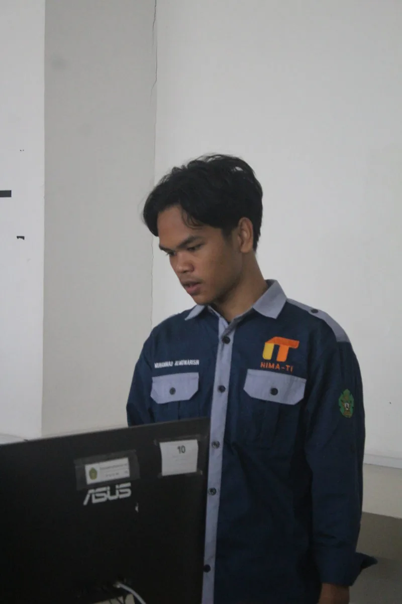

<div align="center">



<h1>Muhammad Almuwarisin</h1>

<p>
Web Developer &middot; Mahasiswa Teknologi Informasi, UIN Ar-Raniry Banda Aceh
</p>

<p>
<a href="https://ayries18.github.io/Portofolio/">Live Website</a> &middot;
<a href="https://github.com/Ayries18">GitHub</a> &middot;
<a href="https://www.linkedin.com/in/muhammad-almuwarisin-934079376/">LinkedIn</a>
</p>

</div>

---

## Tentang

Portofolio pribadi berbasis HTML, CSS, dan JavaScript murni, tanpa framework dan
tanpa build step. Dibangun untuk menunjukkan penguasaan fundamental
web: navigasi berbasis tab, dark mode, dan aksesibilitas keyboard.

Selain developing web, saya mengerjakan **Read-Assist**, aplikasi audiobook untuk
penyandang disabilitas netra, yang dibangun sendiri dari nol.

Saat ini saya **terbuka untuk magang dan internship**.

---

## Teknologi

<p align="center">
  
  
  
  
  
  
  
  
</p>

---

## Proyek

### Milik saya sendiri

| Proyek | Deskripsi | Kode |
| --- | --- | --- |
| [Read-Assist](https://github.com/Ayries18/Read-Assist) | Aplikasi audiobook untuk penyandang disabilitas netra. Teks dari PDF/EPUB diekstrak, diubah menjadi audio di latar belakang, lalu diakses lewat pemindai QR Code pada buku fisik. | [Live Demo](https://readassist.web-id.id/) · [Case Study](case-study-read-assist.html) |
| [Portofolio Personal](https://github.com/Ayries18/Portofolio) | Website ini. Tanpa framework, dengan dark mode, tipografi editorial, dan focus ring global. | [Live Demo](https://ayries18.github.io/Portofolio/) |

### Repository tugas mata kuliah

Keduanya adalah repository perkuliahan. **Kode aplikasinya ditulis oleh rekan
tim, bukan oleh saya.** Kontribusi saya pada kedua repository ini terbatas pada
dokumentasi (`README.md`) dan aset gambar. Saya mencantumkannya di sini
karena saya memakainya sebagai bahan belajar, bukan sebagai hasil build saya.

| Proyek | Deskripsi | Kode |
| --- | --- | --- |
| [LokaPreneur](https://github.com/Ayries18/LokaPreneur) | Platform UMKM berbasis Laravel. Repository sudah memiliki model dan migration, tetapi belum ada fitur aplikasi yang utuh. | [Repository](https://github.com/Ayries18/LokaPreneur) |
| [Portal Berita](https://github.com/Ayries18/Portal-Berita) | Aplikasi berita berbasis Laravel dengan arsitektur MVC. Repository sudah memiliki model `Article` dan tabelnya, tetapi belum ada controller, route, maupun tampilan artikel. | [Repository](https://github.com/Ayries18/Portal-Berita) |

---

## Fitur Website

- Dark mode yang mengikuti setelan sistem, dengan pilihan tersimpan di `localStorage`
- Navigasi berbasis tab tanpa reload halaman
- Tetap terbaca tanpa JavaScript: semua section ditampilkan berurutan
- Layout responsif dengan titik henti di 1024px, 900px, 768px, dan 560px
- `focus-visible` global dan dukungan `prefers-reduced-motion`
 - Ikon SVG inline, tanpa library ikon eksternal
 - Data terstruktur JSON-LD (`schema.org/Person`)
- Kartu pratinjau sosial `og-image.png` berukuran 1200×630
 - Tiga dependensi eksternal: Google Fonts (Inter), Tailwind Play CDN
   (dikonfigurasi mengikuti token desain, preflight mati), dan Open Props
   (kumpulan variabel CSS saja, belum dipakai komponen mana pun)

## Sistem Desain

Semua token warna, tipografi, dan spasi berada di `css/style.css`:

- **Warna** — palet hitam dan ungu. Ungu dipakai hemat: nama di navbar, underline
  tab aktif, satu tombol aksi, link inline, nomor project, dan satu garis aksen
  per judul section. Markah brand pihak ketiga (ikon ticker dan ikon kontak)
  memakai warna resminya sebagai identitas dekoratif, selalu bersanding kata.
- **Gerak** — entrance sekali jalan (hero, terminal, reveal), satu loop
  terkendali (ticker skills, jeda saat hover/fokus), dan semuanya statis
  saat `prefers-reduced-motion` atau tanpa JavaScript.
- **Tipografi** — Inter (`400`/`500`/`600`) untuk teks, system monospace untuk
  metadata dan label. Satu skala dengan sembilan ukuran, semuanya bernama token.
- **Spasi** — kelipatan 4px (`--s-1` sampai `--s-7`), dari `4px` sampai `96px`.
- **Bentuk** — satu radius (`4px`) dan garis rambut 1px. Tanpa gradien, glow,
  bayangan, atau efek kaca.

## Struktur Halaman

- `index.html` — satu halaman, tujuh section sebagai tab: Beranda (nama
  dua baris dengan Character Assembly), Tentang (transkrip terminal +
  papan fakta), Pendidikan, Keterampilan (ticker berjalan), Proyek, Artikel
  (satu publikasi jurnal terverifikasi), dan Kontak. Pendidikan tidak punya link navbar; ia bisa dicapai dari catatan
  di tab Proyek dan punya tombol kembali ke Proyek.
- `case-study-read-assist.html` — studi kasus Read-Assist, halaman terpisah.

Halaman ini tetap terbaca tanpa JavaScript: seluruh section ditampilkan
berurutan dan link navbar bekerja sebagai anchor biasa. Yang berubah tanpa JS
hanya navigasi tab, drawer, dan toggle tema.

---

## Menjalankan Secara Lokal

Tidak ada build step dan tidak ada dependensi.

```bash
git clone https://github.com/Ayries18/Portofolio.git
cd Portofolio
python -m http.server
```

Buka `http://localhost:8000`. Membuka `index.html` langsung di browser juga
berfungsi.

---

## Struktur Proyek

```text
.
├── index.html                      # seluruh konten halaman (arsitektur satu halaman)
├── case-study-read-assist.html     # studi kasus Read-Assist
├── css/style.css                   # token desain, komponen, dan aturan tema
├── javascript/script.js            # navigasi tab, menu mobile, theme toggle, footer year
├── favicon.ico                     # ikon situs (ICO asli, 7 ukuran)
├── favicon-16x16.png               # ikon raster eksplisit
├── favicon-32x32.png               # ikon raster eksplisit
├── apple-touch-icon.png            # ikon iOS 180x180
 ├── og-image.png                    # kartu pratinjau sosial 1200x630
 ├── 404.html                        # halaman error bergaya situs (tanpa JS)
 ├── logo.webp                       # logo navbar yang dirender di halaman
└── profile/                        # foto profil + screenshot 2 proyek solo
    ├── profile.webp                # potret 800x1200 (dipakai hero & README)
    ├── read-assist-preview.webp    # screenshot Read-Assist 1440x810
    └── portofolio-preview.webp     # screenshot Portofolio 1200x590
```

Setiap gambar yang dilacak dipakai minimal satu halaman. Aset yang kehilangan
referensi terakhirnya (`logo.png`, pratinjau `lokapreneur-*` /
`portalberita-*`, duplikat `profile.jpg` dan `portofolio-preview.png`) sudah
dihapus setelah pindaian referensi — tidak disimpan sebagai cadangan.

---

## Kontak

- Email: [muwarisin@gmail.com](mailto:muwarisin@gmail.com)
- GitHub: [github.com/Ayries18](https://github.com/Ayries18)
- LinkedIn: [linkedin.com/in/muhammad-almuwarisin-934079376](https://www.linkedin.com/in/muhammad-almuwarisin-934079376/)

---

## Catatan

Halaman ini tidak mengklaim jumlah pengguna, dampak bisnis, atau hasil audit
aksesibilitas resmi. Fitur aksesibilitas pada Read-Assist disusun mengikuti
praktik web yang baik, belum diuji bersama pengguna disabilitas netra.
